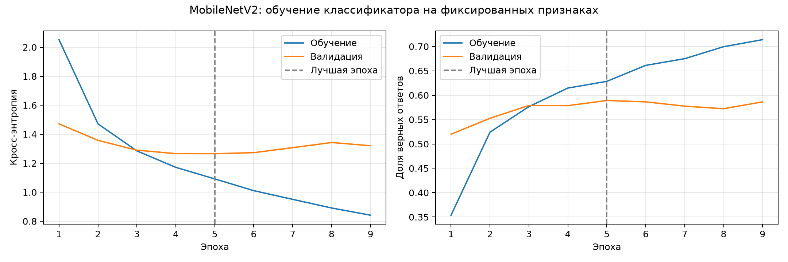
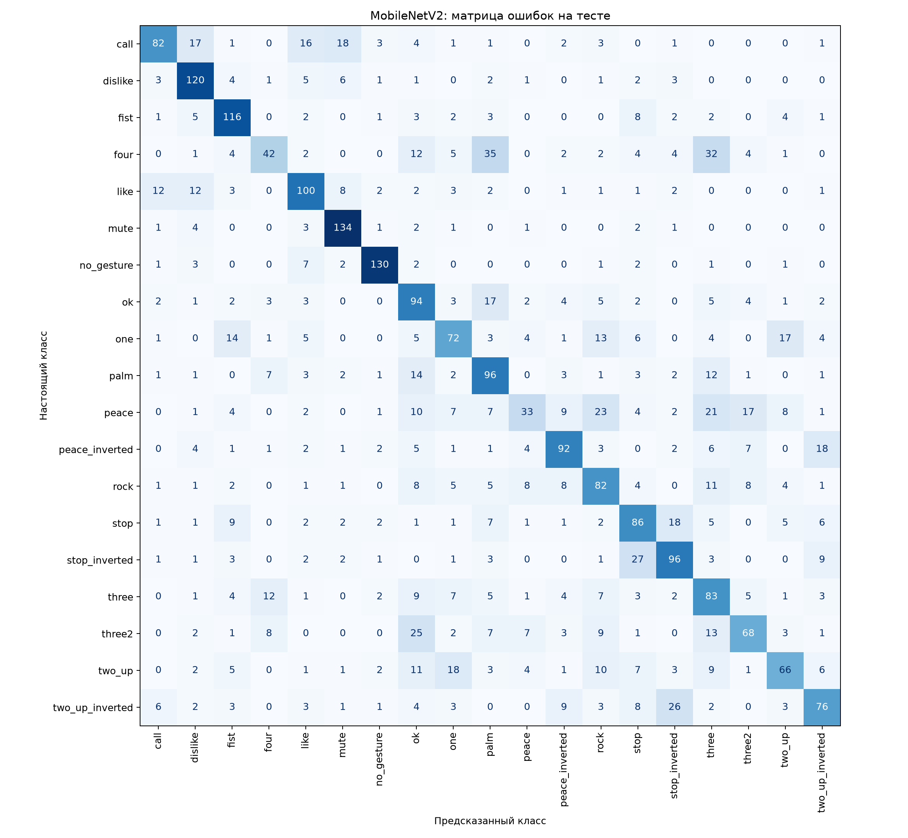
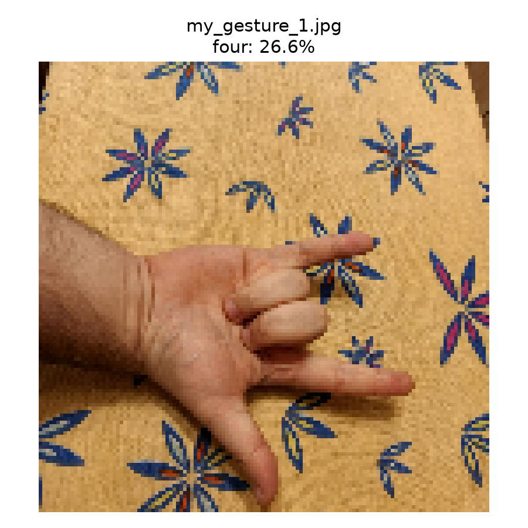
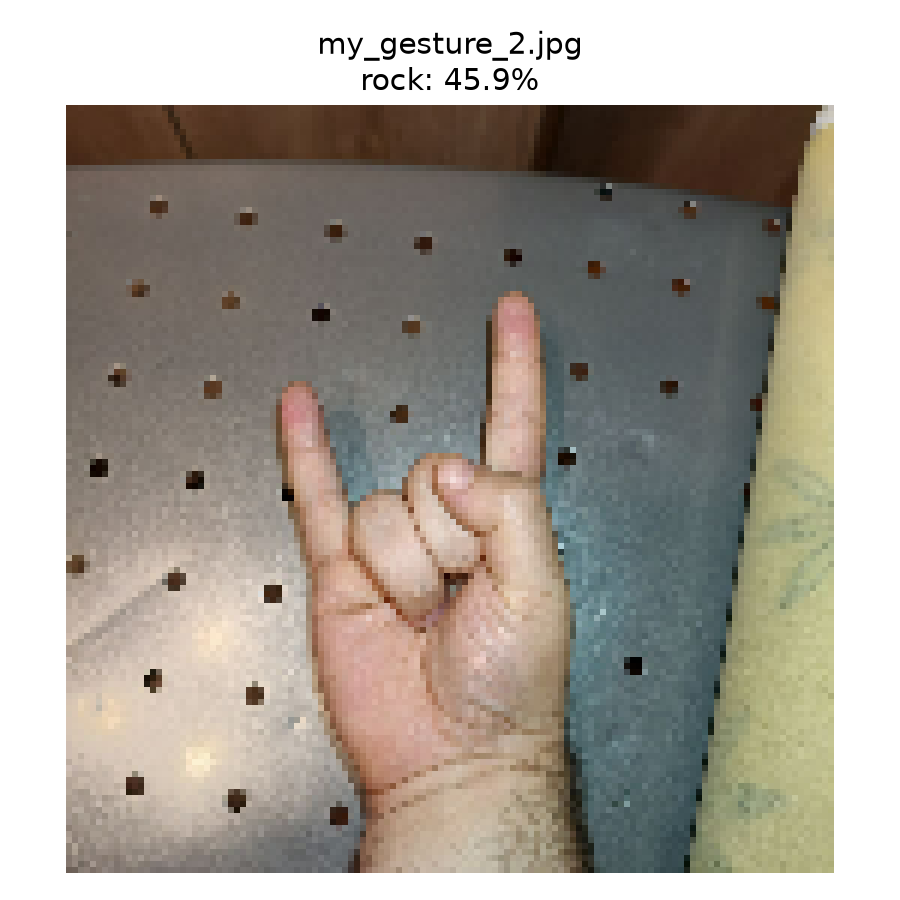

# lab1-spaceship-titanic
Лабораторная работа №1. Предобработка данных Spaceship Titanic

## Лабораторная работа №2
Решены задачи регрессии и классификации на данных Spaceship Titanic.
Использовано разбиение из первой лабораторной: 70% данных для обучения,
30% — для тестирования.

### Регрессия
Линейная регрессия предсказывает возраст пассажира.
Из входных признаков исключены Age и Transported.
Для обучения и оценки использованы только строки с известным
исходным возрастом.

Результаты на тестовой выборке:
- MAE: 11,01 года;
- RMSE: 14,04 года;
- R²: 0,0657.

MAE постоянного прогноза средним возрастом составляет 11,42 года.
Модель улучшает этот результат незначительно. Прогнозы сосредоточены
около среднего возраста: детям возраст обычно завышается,
пожилым пассажирам — занижается.

Для улучшения можно добавить признаки состава группы пассажиров,
проверить преобразования расходов и нелинейные зависимости.
Эффективность изменений следует проверять кросс-валидацией
на обучающей выборке.

### Классификация

Логистическая регрессия предсказывает значение Transported.
Целевой столбец исключён из входных признаков.

Результаты:
- Accuracy на обучении: 77,01%;
- Accuracy на тесте: 75,81%;
- Accuracy постоянного прогноза наиболее частым классом: 50,35%;
- Precision класса «Перенесён»: 0,7991;
- Recall класса «Перенесён»: 0,6938;
- F1 класса «Перенесён»: 0,7428.

Для улучшения можно добавить признаки расходов и группы пассажиров,
подобрать силу регуляризации на кросс-валидации. Если важнее
обнаруживать перенесённых пассажиров, можно подобрать порог
классификации на валидационных данных с учётом precision и recall.

## Лабораторная работа №3
Применены деревья решений для регрессии возраста и классификации
пассажиров по признаку Transported. Использованы подготовленные
данные и разбиение на обучение и тест из первой работы.

Для обеих моделей заданы max_depth=5, min_samples_leaf=30
и random_state=42. Автоматический подбор параметров не проводился.

### Регрессия

DecisionTreeRegressor предсказывает возраст в годах.
Использованы только строки с известным исходным возрастом.
Age и Transported исключены из входных признаков.

Результаты на тестовой выборке:
- MAE: 10,82 года;
- RMSE: 13,73 года;
- R²: 0,1069.

Дерево немного улучшило результат линейной регрессии из второй
работы, где MAE составляла 11,01 года. Однако качество остаётся
невысоким: модель объясняет около 10,7% вариации возраста.

Горизонтальные полосы на графике связаны с устройством дерева:
всем объектам одного листа назначается одинаковый прогноз —
средний возраст обучающих объектов этого листа.

### Классификация и ROC-кривая

DecisionTreeClassifier предсказывает Transported.
Целевая переменная исключена из входных признаков.

Результаты:
- Accuracy на обучении: 77,73%;
- Accuracy на тесте: 77,72%;
- Precision класса «Перенесён»: 0,7392;
- Recall класса «Перенесён»: 0,8614;
- F1 класса «Перенесён»: 0,7956;
- ROC AUC на тесте: 0,8528.

ROC-кривая построена по вероятностям класса 1.
AUC характеризует качество ранжирования объектов и не равна accuracy.

По сравнению с логистической регрессией accuracy выросла
на 1,91 процентного пункта. Полнота класса «Перенесён» увеличилась,
но precision снизилась: модель обнаруживает больше перенесённых
пассажиров ценой большего числа ложных срабатываний.

Accuracy на обучении и тесте почти совпадает. По этим оценкам
выраженных признаков сильного переобучения классификатора нет.

### Выводы

Деревья немного превзошли линейные модели на рассматриваемом
разбиении. Классификация дала более полезный результат,
чем прогнозирование возраста.

Для улучшения можно подобрать глубину дерева и минимальное
число объектов в листе, а также добавить информативные признаки.
Подбор следует проводить на обучающих данных с помощью
кросс-валидации, сохраняя тестовую выборку для итоговой оценки.

## Лабораторная работа №4

Решена задача классификации пассажиров по признаку Transported
с помощью случайного леса, AdaBoost и градиентного бустинга.

### Результаты

| Модель | Accuracy на обучении | Accuracy на тесте | ROC AUC |
|---|---:|---:|---:|
| Random Forest | 0,8366 | 0,7972 | 0,8826 |
| AdaBoost | 0,7814 | 0,7646 | 0,8643 |
| Gradient Boosting | 0,8156 | 0,8029 | 0,8894 |

Accuracy постоянного прогноза наиболее частым классом — 0,5035.
Все три модели превзошли этот ориентир.

### OOB-оценка случайного леса

- OOB accuracy: 0,7982;
- OOB error: 0,2018.

### ROC-кривые

ROC-кривые построены по вероятностям класса 1.
Они показывают соотношение доли ложных срабатываний
и доли обнаруженных объектов класса 1 при разных порогах.

Наибольшая площадь под ROC-кривой получена у градиентного
бустинга: AUC = 0,8894. Случайный лес показал близкий
результат — 0,8826, AdaBoost — 0,8643.
AUC не равна доле правильных ответов.

### Выводы

При выбранных параметрах и разбиении лучший результат
показал градиентный бустинг: accuracy — 80,29%.
Он превзошёл случайный лес на 0,57 процентного пункта
и одиночное дерево из третьей работы на 2,57 процентного пункта.

Преимущество градиентного бустинга перед случайным лесом
небольшое. Результат одного разбиения не доказывает
превосходство метода во всех задачах.

Для дальнейшего улучшения можно подобрать число деревьев,
их глубину и скорость обучения на кросс-валидации,
а также добавить информативные признаки. При подборе
предобработку следует выполнять внутри обучающих частей
каждого разбиения, не используя тестовые данные.

## Лабораторная работа №5.

Реализована нейронная сеть MLP на NumPy для классификации
синтетических примеров по двум классам:
«Правящая партия» и «Оппозиция».

### Данные и модель

- 100 примеров с 12 бинарными признаками.
- Разделение: 50 примеров для обучения, 20 для валидации, 30 для тестирования.
- Архитектура: 12 входов → 8 скрытых нейронов → 2 выхода.
- Функции активации: sigmoid в скрытом слое и softmax на выходе.
- Функция потерь: кросс-энтропия.
- Обучение: обратное распространение ошибки и градиентный спуск.
- Скорость обучения: 0.1, количество эпох: 2000.

После обучения восстановлены веса эпохи с минимальной ошибкой
на валидационной выборке.

### Результаты

| Показатель | Значение |
|---|---:|
| Выбранная эпоха | 25 |
| Минимальная ошибка валидации | 0.6967 |
| Accuracy на обучении | 0.5600 |
| Accuracy на тесте | 0.6333 |
| Accuracy постоянного прогноза | 0.5333 |

На тестовой выборке правильно классифицированы 19 из 30 примеров.

### Выводы

При продолжении обучения ошибка на обучающей выборке снижалась,
а на валидационной росла. Это указывает на переобучение.
Выбор весов по минимальной ошибке валидации позволил сохранить
модель до дальнейшего ухудшения результата.

Входные признаки и классы сгенерированы случайно и независимо,
поэтому устойчивой закономерности между ними нет.
Полученная точность на небольшом тесте не доказывает способность
модели обобщать данные. Работа демонстрирует реализацию и обучение
MLP, а также выявление переобучения.

## Лабораторная работа №6. Распознавание жестов

Цель работы — обучить свёрточную нейронную сеть распознавать
жесты рук и проверить её на собственных фотографиях.

### Данные

Использована подготовленная версия датасета
[HaGRID](https://huggingface.co/datasets/cj-mills/hagrid-classification-512p-no-gesture-150k-zip),
содержащая 153 735 изображений и 19 классов.

Для экспериментов случайно выбрано по 1000 изображений каждого класса:

- обучение — 13 300 изображений;
- валидация — 2850 изображений;
- тест — 2850 изображений.

Все модели использовали одинаковое разделение данных.
Список изображений и их принадлежность к выборкам сохранены
в `dataset_split.csv`.

### Модели и результаты

| Модель | Размер входа | Accuracy на тесте |
|---|---|---:|
| Исходная CNN | 64 × 64 | 35,47% |
| CNN с поворотами и Dropout | 64 × 64 | 41,54% |
| MobileNetV2 с предобученными весами ImageNet | 128 × 128 | 58,53% |

В исходной CNN использованы два свёрточных слоя,
слои MaxPooling и полносвязный классификатор.

Во втором варианте добавлены случайные повороты изображений
и Dropout для уменьшения переобучения.

В третьем варианте MobileNetV2 использовалась как замороженный
экстрактор признаков. Обучался только новый классификатор
для 19 классов жестов. Значения пикселей преобразовывались
из диапазона 0–255 в диапазон −1–1.

Состояние каждой модели выбиралось по минимальной ошибке
на валидационной выборке.

### Результат MobileNetV2

- Лучшая эпоха — 5.
- Ошибка на валидации — 1,2660.
- Accuracy на валидации — 58,91%.
- Ошибка на тесте — 1,2529.
- Accuracy на тесте — 58,53%.
- Правильно классифицированы 1668 из 2850 тестовых изображений.

### Проверка собственных фотографий

| Фотография | Предсказание MobileNetV2 | Оценка softmax |
|---|---|---:|
| my_gesture_1.jpg | four | 26,60% |
| my_gesture_2.jpg | rock | 45,87% |

Второй снимок с жестом rock распознан правильно.
На первом снимке модель ошиблась. Оценка softmax показывает
относительное предпочтение класса моделью и не гарантирует
правильности ответа.

### Выводы

Применение предобученной MobileNetV2 повысило тестовую точность
на 16,99 процентного пункта относительно CNN с аугментацией
и Dropout. Перенос обучения оказался эффективным
в условиях данного эксперимента.

После лучшей эпохи ошибка обучения продолжала снижаться,
а ошибка валидации перестала улучшаться.
Сохранение лучшего состояния ограничило влияние переобучения.

Качество распознавания остаётся неодинаковым для разных жестов.
Например, модель распознала 134 из 150 примеров mute,
но только 33 из 150 примеров peace.

Разделение выполнено по изображениям и не гарантирует,
что одни и те же люди отсутствуют в разных выборках.
Результаты собственных фотографий являются демонстрацией,
а не достаточной проверкой надёжности модели.

### Файлы

- `lab6.py` — обучение исходной CNN.
- `lab6_improved.py` — CNN с поворотами и Dropout.
- `lab6_predict.py` — проверка фотографий для первых двух моделей.
- `lab6_mobilenet.py` — обучение классификатора MobileNetV2,
  оценка и проверка собственных фотографий.
- `lab6_results_mobilenet/` — сохранённая модель, метрики,
  прогнозы и графики.
- `lab6_photos/` — собственные фотографии.

### Запуск MobileNetV2

Использованы Python 3.12.10 и TensorFlow 2.21.0.

Установка зависимостей:

    python -m pip install tensorflow matplotlib numpy pandas scikit-learn pillow

Запуск в Windows из папки проекта:

    .\.venv_lab6\Scripts\python.exe lab6_mobilenet.py

Для запуска необходимы:

- распакованный датасет в
  `lab6_data/hagrid-classification-512p-no-gesture-150k/`;
- `dataset_split.csv` и `class_names.json` в `lab6_results/`;
- фотографии для проверки в `lab6_photos/`.

При первом запуске требуется интернет для загрузки весов ImageNet.
Датасет и виртуальные окружения в репозиторий не включены.

### Графики

### Файлы
- main.py — предобработка данных первой лабораторной;
- lab2.py — обучение и оценка моделей второй лабораторной;
- lab2_results/metrics.txt — метрики;
- lab2_results/regression.png — график прогнозирования возраста;
- lab2_results/confusion_matrix.png — матрица ошибок;
- lab2_results/regression_predictions.csv — прогнозы возраста;
- lab2_results/classification_predictions.csv — прогнозы классов.
- lab3.py — подготовка данных, обучение и оценка деревьев третьей лабараторной;
- lab3_results/metrics.txt — параметры и метрики моделей;
- lab3_results/roc_curve.png — ROC-кривая классификатора;
- lab3_results/regression.png — график прогнозирования возраста;
- lab3_results/regression_predictions.csv — прогнозы возраста;
- lab3_results/classification_predictions.csv — классы и вероятности.
- lab4.py — обработка данных четвёртой лабараторной;
- lab4_results/metrics.txt — параметры, OOB-оценка и метрики;
- lab4_results/model_comparison.csv — сравнение моделей;
- lab4_results/predictions.csv — предсказанные классы и вероятности;
- lab4_results/roc_curves.png — общий график ROC-кривых.
- lab5.py — подготовка данных, обучение и оценка модели.
- lab5_data/ — входные данные и правильные ответы.
- lab5_results/ — метрики, прогнозы, история обучения,
  сохранённые веса и графики.
